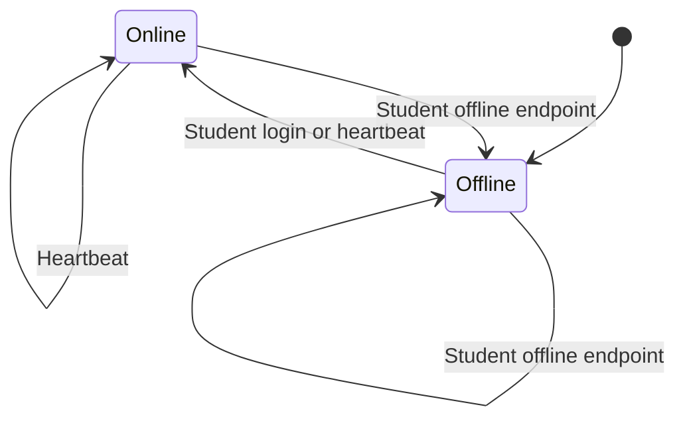
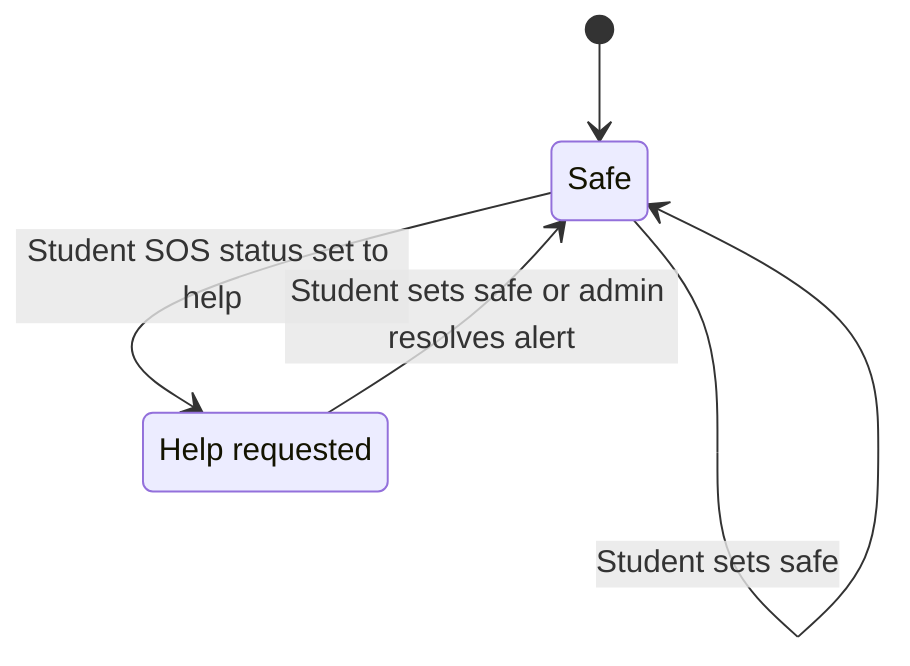

# GTrack State Transition Flow

This diagram describes the student connectivity/SOS states and the SOS alert lifecycle implemented by the current Laravel application.

## Student status

Connectivity (`online`/`offline`) and SOS state (`safe`/`help`) are separate values. A status update records a new student-status history entry; changing SOS state does not by itself change connectivity.

The `/student/sos` endpoint updates the student's SOS state and recorded status. Setting it to `safe` also resolves that student's unresolved emergency alerts. An SOS alert record is created through the media-upload endpoint; this is a separate action from setting the student's SOS state to `help`.

## SOS alert lifecycle

```mermaid
stateDiagram-v2
    state "Pending" as Pending
    state "Resolved" as Resolved

    [*] --> Pending: SOS alert created
    Pending --> Pending: Admin acknowledges\n(record acknowledgment; status stays pending)
    Pending --> Resolved: Admin resolves
    Pending --> Resolved: Student sets SOS safe
    Resolved --> [*]
```

Acknowledgment records the admin and timestamp, and sends a message to the student; it does not change the alert's `pending` status. Resolving marks the alert resolved and the student's SOS state safe. Admin resolution fills in acknowledgment metadata when it was not already recorded.

## Implementation notes

- Login and heartbeat record the student as `online`; the offline endpoint records `offline`.
- The status API also derives online/offline from the latest location timestamp, treating a location at least 10 minutes old as offline. This is a response-time calculation and does not update the stored status history.
- Student SOS states are `safe` and `help`; newly created emergency alerts use `pending` and resolved alerts use `resolved`.
