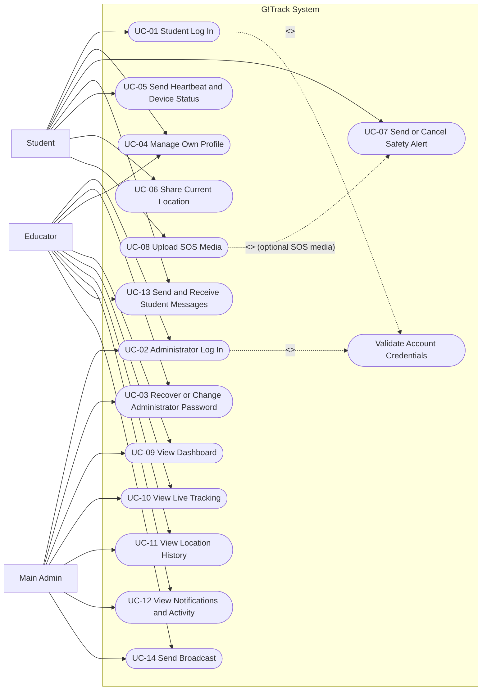

# G!Track Use Case Diagram

This diagram summarizes the 14 use cases in [GTrack_Use_Case_Narrative.md](GTrack_Use_Case_Narrative.md). The actors are Student, Educator, and Main Admin. Student mobile-app background actions are represented by the Student actor rather than by a separate app actor.

## Use Case Diagram

## Actor Responsibilities

| Actor | Responsibilities |
|---|---|
| **Student** | Signs in to the mobile app, manages their profile, and uses the app to report device status and location, send or cancel safety alerts, upload optional SOS media, and exchange messages. |
| **Educator** | Signs in to the web portal, manages their profile and password, monitors the dashboard and student locations, reviews history and notifications, communicates with students, and sends broadcasts. |
| **Main Admin** | Signs in to the web portal, recovers their password, monitors the dashboard and student locations, reviews history and notifications, and sends broadcasts. |

## Use Case Summary

| ID | Use case | Primary actor(s) | System behavior |
|---|---|---|---|
| UC-01 | Student Log In | Student | Validates student credentials and grants access to the mobile app. |
| UC-02 | Administrator Log In | Educator, Main Admin | Authenticates the administrator and routes first-time accounts through password setup before dashboard access. |
| UC-03 | Recover or Change Administrator Password | Educator, Main Admin | Recovers a password using Staff ID and registered email; Educators can also change their password while signed in. |
| UC-04 | Manage Own Profile | Student, Educator | Validates and saves the profile changes permitted for the user's role. |
| UC-05 | Send Heartbeat and Device Status | Student | Updates student online status and the latest submitted status information. |
| UC-06 | Share Current Location | Student | Validates and records the student's coordinates and timestamp for monitoring and history. |
| UC-07 | Send or Cancel Safety Alert | Student | Records a student safety alert or updates the student's state when safe. |
| UC-08 | Upload SOS Media | Student | Validates and stores optional media associated with an SOS event. |
| UC-09 | View Dashboard | Educator, Main Admin | Displays student status, recent updates, and alert summaries. |
| UC-10 | View Live Tracking | Educator, Main Admin | Displays available student locations and supports class filtering. |
| UC-11 | View Location History | Educator, Main Admin | Retrieves and displays a selected student's recorded location timeline. |
| UC-12 | View Notifications and Activity | Educator, Main Admin | Displays alerts, messages, broadcasts, and activity; supports applicable alert actions. |
| UC-13 | Send and Receive Student Messages | Student, Educator | Saves and displays messages in the student-Educator conversation. |
| UC-14 | Send Broadcast | Educator, Main Admin | Saves a broadcast and recipient records for the selected student audience. |

## Relationships

| Source | Relationship | Target |
|---|---|---|
| UC-01: Student Log In | `<<include>>` | Validate Account Credentials |
| UC-02: Administrator Log In | `<<include>>` | Validate Account Credentials |
| UC-08: Upload SOS Media | `<<extend>>` (optional SOS media) | UC-07: Send or Cancel Safety Alert |

## Access Notes

- Administrator web pages require an authenticated administrator session.
- The student login, automated heartbeat/location reporting, safety alert, and student-originated messaging actions are mobile app workflows.
- The web administrator password recovery flow uses Staff ID and registered email; the current implementation does not use a 6-digit OTP.
- Student and administrator access and available actions depend on their authenticated role.
